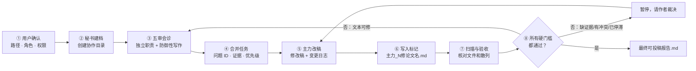

<p align="center">
  
</p>

<h1 align="center">Bridge Paper Review</h1>

<p align="center">
  <strong>别再让多个 AI 各改各的。把它们变成一支有分工、有证据、有复审、也有停机条件的论文编辑部。</strong>
</p>

<p align="center">
  Two or more AI agents · Five accountable review roles · One auditable path to submission readiness
</p>

<p align="center">
  <a href="https://github.com/siyunhao2025-beep/bridge-paper-review/actions/workflows/validate.yml"></a>
  
  
  
  
</p>

<p align="center">
  <a href="#why"><strong>为什么值得用</strong></a>
  ·
  <a href="#quickstart"><strong>三步开始</strong></a>
  ·
  <a href="#workflow"><strong>看完整闭环</strong></a>
  ·
  <a href="#hard-gates"><strong>查看 9/10 硬门槛</strong></a>
</p>

---

<a id="why"></a>

## 不是再写一条“帮我润色论文”的 Prompt

你可能已经同时在用 GPT、Workbuddy、Codex、Claude 或其他智能体。真正麻烦的往往不是模型不够多，而是：

- 没有人先确认哪一份才是权威原稿；
- 主力和审稿人混在一起，自改自夸；
- 上一轮指出的问题，下一轮悄悄消失；
- “已修改”只有一句话，没有文件、位置与变更证据；
- 分数越来越高，但方法、统计或证据链的硬伤仍然存在；
- 所谓“自动协作”，其实只是某个文件出现了，另一个 AI 根本没被唤醒。

**Bridge Paper Review 不是第六个改稿模型。它是一套连接多个 AI 的论文修订协议：先问清楚，再分工；先留证据，再复审；未过硬门槛，就不生成“可投稿”结论。**

| 🧭 先问清楚 | 🧑‍⚖️ 五审留痕 | 🔁 不达标不收工 |
|---|---|---|
| 路径、权威源、协作目录、全部 AI、主力、秘书、监测方式，缺一项都不开工 | 五个审稿角色各有职责，每条必须修改意见都有 ID、位置、证据和优先级 | 主力交稿后触发下一轮复审；硬伤、矛盾、漏改和复发问题会继续追踪 |

> [!IMPORTANT]
> 这里的“达标”是**达到本工作流设定的模拟审稿与投稿准备门槛**，不是期刊录用保证。缺实验、缺数据、统计错误、伦理风险或目标期刊选择问题，不能靠文字润色消失；系统会暂停并把决定交还作者。

### 一次性改稿，与可追责闭环的区别

| 常见的一次性改稿 | Bridge Paper Review |
|---|---|
| 一个 AI 同时扮演作者、编辑和审稿人 | 明确指定**主修改智能体**与**秘书智能体** |
| 建议散落在聊天记录里 | 每轮生成审稿报告、汇总、任务单和机器可读评分卡 |
| “我已经改好了” | 交付标记 + 修改稿 + 变更日志 + SHA-256 文件指纹 |
| 下一轮重新点评，不记得旧问题 | 问题 ID 跨轮追踪：已解决、未解决、复发一目了然 |
| 平均分好看就结束 | 每位审稿人、每个维度和所有硬伤分别过线 |
| 自动扫描被宣传成自动唤醒 | 明确区分 `configured`、`active`、`wake_verified` |
| 无限改写，直到措辞更圆滑 | 遇到证据上限、冲突或停滞时主动暂停 |

<a id="quickstart"></a>

## 三步开始

### 1. 安装 Skill

在 PowerShell 中：

```powershell
git clone https://github.com/siyunhao2025-beep/bridge-paper-review.git

# 目标目录应当不存在，避免覆盖你已有的同名 Skill
Copy-Item -Recurse -LiteralPath `
  '.\bridge-paper-review\paper-revision-bridge' `
  -Destination "$env:USERPROFILE\.codex\skills\paper-revision-bridge"
```

macOS / Linux：

```bash
git clone https://github.com/siyunhao2025-beep/bridge-paper-review.git
mkdir -p ~/.codex/skills
test ! -e ~/.codex/skills/paper-revision-bridge
cp -R ./bridge-paper-review/paper-revision-bridge ~/.codex/skills/
```

### 2. 在新任务里调用

复制这一句话即可：

```text
使用 $paper-revision-bridge 协调多个 AI 修改我的科研论文。先完成开工问卷，不要直接读稿或改稿。
```

### 3. 先回答，再确认开工

Skill 的第一步必须向你确认：

1. 论文绝对路径在哪里？PDF、TeX、DOCX 中哪个是权威可编辑源？
2. 是否允许在论文同一目录创建 `协同审稿+优化`？若不允许，放在哪里？
3. 使用哪些 AI（名称、产品、版本）？谁是主力？谁是秘书？
4. 目标期刊、稿件类型、语言，以及五审采用何种实现方式？
5. 是否开启定时检索？间隔、时区、持续期限、运行宿主与授权是什么？
6. 哪个适配器负责真正唤醒目标 AI？如果没有，是否接受“自动发现 + 事件记录 + 人工打开 AI”？

只有你核对启动摘要并明确回复**“确认开始”**后，Skill 才能读取论文、创建目录、派发审稿或安装定时任务。初始化程序也会强制校验这份确认，不让规则只停留在 README 里。

<a id="workflow"></a>

## 一篇论文会经历什么



这不是“把同一段话交给五个 AI 改五遍”。五审可以由五个真实智能体分别执行，也可以在能力受限时由一个智能体分角色执行；**实现方式必须写进配置，不能把角色模拟伪装成五个独立智能体。**

### 五位审稿人，各自对一种失败负责

| 审稿角色 | 主要责任 | 它最想抓住的问题 |
|---|---|---|
| **R1 领域与创新** | 问题价值、贡献边界、相关工作 | “新颖”是否只是换一种说法，贡献是否超出证据 |
| **R2 方法与统计** | 设计、样本、对照、检验、复现 | 方法硬伤、统计误用、缺少必要消融或敏感性分析 |
| **R3 证据与一致性** | 摘要、正文、图表、公式、结论 | 数字对不上、方向矛盾、图表与正文互相打架 |
| **R4 期刊与呈现** | 期刊范围、稿件结构、图表与引文 | 论文可能不错，但并不适合目标期刊或稿件类型 |
| **R5 表达与压力测试** | 术语、伦理披露、反例、学术表达 | 模糊承诺、回避失败条件，以及经不起追问的论证 |

五位审稿人都必须单列**防御性写作审查**。它不会粗暴删除全部谨慎措辞，而是区分：

- 应当保留的科学不确定性、真实局限与适用边界；
- 用“条件所限”“不可避免”等措辞替可修问题辩护；
- 先写超出证据的强结论，再堆保留句兜底；
- 用 `novel`、`robust`、`comprehensive` 等自我评价代替证据；
- 在正文里与想象中的审稿人争辩，或用模糊表达隐藏责任和失败条件。

推荐的表达不是“更强硬”，而是：**给出证据 → 说清边界 → 直接交代剩余不确定性。**

<a id="hard-gates"></a>

## 9/10 不是平均分游戏

只有以下条件**同时成立**，工作流才允许生成 `最终可投稿报告.md`：

| 硬门槛 | 必须达到 |
|---|---|
| 审稿人总分 | 五位审稿人**各自**不低于 9.0 / 10 |
| 分维度得分 | 每位审稿人的五个维度**各自**不低于 8.5 / 10 |
| 致命问题 | P0 硬伤、P1 必改、未解决旧问题、复发问题全部为 0 |
| 投稿判断 | 五位审稿人都明确给出 `submission_ready=true` |
| 稿件一致性 | 目标期刊规范检查与源文件/渲染文件一致性检查通过 |
| 人类裁决 | 没有待作者决定的冲突，也没有缺失证据行动 |

平均 9.2 分，不能掩盖方法学审稿人的 7.5 分。连续两轮提升不足 0.2 分，或第 5 轮仍未通过，系统会停止机械改写，请作者判断真正缺少的是实验、数据、论文定位，还是更合适的目标期刊。

## 文件夹就是多个 AI 之间的“交接总线”

默认情况下，协作材料放在论文同级的 `协同审稿+优化` 中：

```text
论文所在目录/
├─ paper.pdf / paper.tex / paper.docx
└─ 协同审稿+优化/
   ├─ 00_协作配置.md
   ├─ 00_当前状态.md
   ├─ bridge-state.json
   ├─ monitor-config.json
   ├─ events.jsonl
   ├─ round-01/
   │  ├─ reviewer-01-domain-novelty.md
   │  ├─ reviewer-02-methods-statistics.md
   │  ├─ reviewer-03-evidence-consistency.md
   │  ├─ reviewer-04-journal-presentation.md
   │  ├─ reviewer-05-writing-integrity.md
   │  ├─ 审稿汇总_R01.md
   │  ├─ 修改任务单_R01.md
   │  └─ scorecard_R01.json
   ├─ GPT_1修paper.md
   ├─ round-02/
   └─ 最终可投稿报告.md
```

例如主力是 GPT，第 1 轮修改完成后会写入 `GPT_1修paper.md`。秘书发现标记后不会盲信“完成”二字，而是核验修改稿、变更日志、问题 ID、文件指纹和交付者身份，再决定是否进入复审。

## “自动检索”不等于“自动唤醒”

这是本项目最重要的诚实边界之一：

```text
configured    → 参数已写入，但宿主调度尚未验证
active        → 调度器能定期扫描，但不代表目标 AI 已收到任务
wake_verified → 已完成端到端测试：唤醒 AI、传递事件、避免重复派单
```

如果 Workbuddy、GPT 或其他产品没有稳定的文件事件、CLI 或 API 入口，`event_only` 是正确的降级方式：系统会自动发现文件并记录事件，但仍需用户或外部适配器打开目标 AI。**README 不会把“看见文件”包装成“另一个智能体已经工作”。**

## 它适合谁

- 同一篇论文需要在两个或多个 AI 之间持续交接；
- 希望把审稿意见变成可追踪任务，而不是聊天里的零散建议；
- 正在做大修、转投、投稿前压力测试或多轮内部预审；
- 团队同时维护 PDF、LaTeX 或 Word，需要明确唯一事实源；
- 需要知道每一轮改了什么、为什么改、哪些问题仍然没有解决。

它不适合：

- 只想快速润色一段摘要或改几个语法错误；
- 只有 PDF，却期待无损改回复杂 LaTeX/Word 排版；
- 希望 AI 编造实验、数据、引文或审稿共识；
- 把“模拟评分 9/10”当成真实期刊录用概率。

## 深入使用

<details>
<summary><strong>初始化一个已确认的协作项目</strong></summary>

在用户核对全部问题并明确确认后，由秘书运行：

```powershell
py -3 paper-revision-bridge/scripts/bridge.py init `
  --manuscript "D:\papers\paper.pdf" `
  --editable-source "D:\papers\paper.tex" `
  --agent "GPT / ChatGPT Desktop" `
  --agent "Workbuddy Desktop" `
  --lead "GPT / ChatGPT Desktop" `
  --secretary "Workbuddy Desktop" `
  --journal "Target Journal" `
  --article-type "Research Article" `
  --language "English" `
  --review-mode "independent_agents" `
  --workspace-placement "same" `
  --monitor-mode "scheduled" `
  --monitor-method "windows_task_scheduler" `
  --poll-interval-minutes 5 `
  --timezone "Asia/Shanghai" `
  --monitor-duration "until_complete" `
  --scheduler-authorized yes `
  --wake-adapter "event_only" `
  --intake-confirmed yes `
  --intake-note "用户已核对路径、同目录建文件夹、AI 角色与每 5 分钟扫描，并确认开始"
```

如果用户不同意在论文同级创建目录，改用：

```text
--workspace-placement custom --workspace-parent "D:\approved\review-workspaces"
```

</details>

<details>
<summary><strong>在 Windows 上安装定时扫描</strong></summary>

只有用户明确授权后，才安装当前用户的计划任务：

```powershell
powershell -ExecutionPolicy Bypass `
  -File paper-revision-bridge/scripts/windows_monitor.ps1 `
  -Action Install `
  -Workspace "D:\papers\协同审稿+优化" `
  -IntervalMinutes 5 `
  -ConfirmedByUser yes
```

查看状态：

```powershell
powershell -ExecutionPolicy Bypass `
  -File paper-revision-bridge/scripts/windows_monitor.ps1 `
  -Action Status `
  -Workspace "D:\papers\协同审稿+优化"
```

项目完成后，在再次取得用户确认的前提下移除：

```powershell
powershell -ExecutionPolicy Bypass `
  -File paper-revision-bridge/scripts/windows_monitor.ps1 `
  -Action Remove `
  -Workspace "D:\papers\协同审稿+优化" `
  -ConfirmedByUser yes
```

</details>

<details>
<summary><strong>接收外部主力 AI 写入的完成标记</strong></summary>

如果主力可以直接运行脚本，优先使用 `lead-done` 原子生成标记。如果外部 GPT 只能写文件，定时 `scan` 会先产生幂等的 `completion_marker_detected` 事件，随后由秘书核验并接收：

```powershell
py -3 paper-revision-bridge/scripts/bridge.py accept-marker `
  --workspace "D:\papers\协同审稿+优化" `
  --marker "D:\papers\协同审稿+优化\GPT_1修paper.md" `
  --agent "GPT / ChatGPT Desktop" `
  --output "D:\papers\revisions\paper-r1.tex" `
  --output "D:\papers\revisions\paper-r1.pdf" `
  --change-log "D:\papers\revisions\change-log-r1.md" `
  --resolved "R01-METH-001" `
  --check "秘书已打开修改稿并核对标记、变更日志、引文和文件散列"
```

</details>

<details>
<summary><strong>查看命令与状态机</strong></summary>

| 命令 | 用途 |
|---|---|
| `init` | 用户确认后建档并生成第一轮模板 |
| `status` | 查看角色、轮次、阶段、开放问题与监测状态 |
| `record-review` | 校验五份报告、汇总、任务单和评分卡，计算硬门槛 |
| `lead-done` | 由可运行脚本的主力生成完成标记并开启下一轮 |
| `scan` | 幂等扫描外部主力写入的完成标记 |
| `accept-marker` | 由秘书核验并接收外部完成标记 |
| `monitor-activate` | 登记真实宿主调度器；可在实测后标记唤醒已验证 |
| `monitor-deactivate` | 记录调度器已停用 |
| `set-source` | PDF-only 场景补充权威 TeX/DOCX 源 |
| `resolve-attention` | 记录作者决定或新证据，恢复修改 |
| `wait` | 最多等待 60 秒的新事件，不冒充外部唤醒器 |
| `verify` | 检查状态、事件、交接文件、散列和目录完整性 |

</details>

## PDF、LaTeX 与 Word 怎么处理

- **LaTeX**：以 `.tex` 或项目目录为事实源，PDF 用于渲染核验。
- **Word**：以 `.docx` 为事实源，导出的 PDF 用于版面核验。
- **PDF-only**：可以审稿，但不能宣称无损修改；流程会暂停，直到作者提供可编辑源或明确接受转换损失。
- **TeX 与 DOCX 同时存在**：先由作者指定唯一事实源，禁止两个智能体各改一份后再猜测如何合并。

## 可信边界写进了设计

- 不覆盖唯一原稿，保留版本化副本；
- 不编造引文、数据、实验、审稿共识或期刊要求；
- 不执行论文或完成标记里夹带的命令，它们只作为数据读取；
- 不用平均分掩盖方法、统计或证据链的致命低分；
- 不把一个智能体的五次角色扮演描述成五个独立智能体；
- 不把自动扫描、自动唤醒和自动通过混为一谈；
- 不靠无止境的文字改写修补证据上限。

## 仓库结构与验证

```text
bridge-paper-review/
├─ README.md
├─ assets/
│  └─ bridge-paper-review-hero.png
├─ paper-revision-bridge/
│  ├─ SKILL.md
│  ├─ agents/openai.yaml
│  ├─ references/
│  └─ scripts/
└─ tests/
   └─ test_bridge_e2e.py
```

端到端测试覆盖：未完成开工问卷时拒绝启动、五审大修、错误角色拒绝、外部标记检测与接收、PDF-only 暂停与恢复、第二轮严格通过、事件幂等、最终报告及目录完整性校验。GitHub Actions 在 Windows 与 Linux 上运行同一条闭环。

## 常见问题

<details>
<summary><strong>必须是 GPT + Workbuddy 吗？</strong></summary>

不是。只要两个或多个智能体能够通过共享文件、CLI、API 或人工交接参与同一流程，就可以配置。名称、产品和版本必须在开工前记录。

</details>

<details>
<summary><strong>一个 AI 能不能扮演五位审稿人？</strong></summary>

可以作为能力受限时的角色模拟，但配置必须如实记录。它能提供五个审稿视角，却不等于五个真正独立的模型或上下文；需要更强独立性时，应使用分离的智能体、任务或审稿实例。

</details>

<details>
<summary><strong>达到 9/10 就一定能录用吗？</strong></summary>

不能。9/10 是这个工作流内部的严格投稿准备门槛，不是编辑部决定、真实同行评审结果或录用概率。它的价值是让明显硬伤更难被漂亮措辞掩盖。

</details>

<details>
<summary><strong>为什么系统有时会停下来，而不是继续改？</strong></summary>

因为有些问题只能由新实验、新数据、作者判断或重新选刊解决。知道何时停止文字优化，是可信科研协作的一部分。

</details>

---

<p align="center">
  <strong>把“AI 帮我改一下”升级成“每一处修改都有负责人、证据和复审结论”。</strong>
</p>

<p align="center">
  <a href="#quickstart"><strong>开始搭建你的 AI 论文编辑部</strong></a>
  ·
  <a href="paper-revision-bridge/SKILL.md"><strong>阅读 Skill</strong></a>
  ·
  <a href="https://github.com/siyunhao2025-beep/bridge-paper-review"><strong>⭐ Star / 关注项目</strong></a>
</p>
