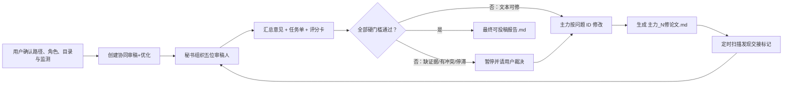

<p align="center">
  
</p>

<h1 align="center">Bridge Paper Review</h1>

<p align="center"><strong>让 AI 不只会改稿，而是组成一支会追责、会复审、也知道何时必须停下来的编辑部。</strong></p>

<p align="center">
  Two or more AI agents. Five accountable reviewers. One auditable path to submission readiness.
</p>

<p align="center">
  <a href="https://github.com/siyunhao2025-beep/bridge-paper-review/actions/workflows/validate.yml"></a>
  
  
  
</p>

## 它解决什么问题

普通的“帮我润色论文”提示词有三个致命缺口：角色混乱、问题不追踪、分数可随口抬高。Bridge Paper Review 把多智能体改稿变成一个可恢复、可审计的文件工作流：

- 一位 AI 是**主修改智能体**，只负责改论文与提交变更证据。
- 一位 AI 是**秘书智能体**，只负责组织审稿、合并意见、追踪问题和维护状态。
- 五位审稿角色从不同维度独立审阅，每个人都必须检查**防御性写作**。
- 每轮都有问题 ID、证据位置、变更日志、文件 SHA-256 和复审结论。
- 定时扫描可以发现 `GPT_1修论文名.md` 一类完成标记；真正唤醒 AI 则通过明确配置的产品适配器完成。
- 只有所有硬门槛同时通过，才生成 `最终可投稿报告.md`。

> [!IMPORTANT]
> 本项目判断的是“达到模拟审稿的可投稿门槛”，不是期刊录用保证。缺实验、缺数据、统计错误、伦理问题或作者判断不能靠润色解决；工作流会暂停并把决定交还用户。

## 开工前必须先问的六件事

这个 Skill 不会拿到一个路径就机械开工。每个新工作流都必须先问完、整理答案、再等待用户明确回复“确认开始”：

1. 论文绝对路径在哪里？PDF、TeX、DOCX 中哪个是权威可编辑源？
2. 是否允许在论文同一目录创建 `协同审稿+优化`？不允许时放在哪里？
3. 会使用哪些 AI（名称、产品、版本）？谁是主力？谁是秘书？
4. 目标期刊、稿件类型、语言与五审实现方式是什么？
5. 是否启用自动定时检索？间隔、时区、持续期限、运行宿主和授权是什么？
6. 用什么适配器真正唤醒 AI？若暂时没有，是否接受“自动扫描 + 事件记录 + 人工打开 AI”？

确认前不读取论文、不创建目录、不派审稿人、不修改文件，也不安装系统定时任务。初始化脚本还会强制要求 `--intake-confirmed yes` 和一段 `--intake-note`，避免这条规则只停留在文档里。

## 工作流一览



## 五位审稿人，不是五次同义改写

| 审稿人 | 主责 | 关键检查 |
|---|---|---|
| R1 | 领域、问题价值与创新性 | 贡献边界、相关工作、期刊范围、过度新颖性声明 |
| R2 | 方法、统计与可复现性 | 设计、样本、对照、统计、消融、敏感性、代码与数据 |
| R3 | 证据链与内部一致性 | 摘要、正文、表、图、公式、结论中的数字与方向是否一致 |
| R4 | 期刊适配、结构与呈现 | 稿件类型、篇章逻辑、图表、引文覆盖、格式与读者定位 |
| R5 | 表达、完整性与压力测试 | 术语、伦理/披露、最强反例、学术表达与防御性写作 |

五位审稿人都必须单列“防御性写作审查”。系统不会粗暴删除所有谨慎措辞，而是区分：

- 必要的科学不确定性、真实局限与适用范围；
- 用“条件所限”“不可避免”等语言替可修问题辩护；
- 先提出超出证据的强结论，再用大量保留句兜底；
- 用 `novel`、`robust`、`comprehensive` 等自我评价替代证据；
- 在论文里与想象中的审稿人争辩，或用模糊表达隐藏责任与失败条件。

推荐修法始终是：**给出证据 → 明确边界 → 直接说明剩余不确定性**。

## 严格的 9/10，不是平均分游戏

工作流只有同时满足以下条件才会结束：

- 五位审稿人的总分**分别**不低于 9.0；
- 每位审稿人的五个维度分别不低于 8.5；
- 所有 `P0 硬伤`、`P1 必改`、未解决旧问题和复发问题为零；
- 五位审稿人都明确给出 `submission_ready=true`；
- 目标期刊规范检查和源文件/渲染件一致性检查通过；
- 没有等待用户裁决的冲突，也没有缺失证据行动。

平均分不能掩盖一位方法学审稿人的低分。连续两轮提升不足 0.2 分，或第五轮仍未通过，工作流会停止机械改写并请求用户判断：缺的是实验、数据、论文定位，还是目标期刊本身不合适。

## 安装

### Codex

```powershell
git clone https://github.com/siyunhao2025-beep/bridge-paper-review.git

# 目标目录不存在时执行；不要覆盖已有同名 Skill。
Copy-Item -Recurse -LiteralPath `
  '.\bridge-paper-review\paper-revision-bridge' `
  -Destination "$env:USERPROFILE\.codex\skills\paper-revision-bridge"
```

然后在新任务中调用：

```text
使用 $paper-revision-bridge 协调多个 AI 修改我的科研论文。
```

### 其他智能体产品

把 [`paper-revision-bridge/SKILL.md`](paper-revision-bridge/SKILL.md) 作为系统技能/项目指令加载，并确保至少秘书智能体能访问同一文件系统与 Python 3.10+。如果某个网页端 GPT 无法访问本机路径，它不能被描述为已接入；需要桌面文件权限、CLI、API 或人工交接。

## 初始化示例

用户确认启动清单后，秘书运行：

```powershell
py -3 paper-revision-bridge/scripts/bridge.py init `
  --manuscript "D:\papers\paper.pdf" `
  --editable-source "D:\papers\paper.tex" `
  --agent "GPT / ChatGPT Desktop" `
  --agent "Workbuddy Desktop" `
  --lead "GPT / ChatGPT Desktop" `
  --secretary "Workbuddy Desktop" `
  --journal "Target Journal" `
  --article-type "Research Article" `
  --language "English" `
  --review-mode "independent_agents" `
  --workspace-placement "same" `
  --monitor-mode "scheduled" `
  --monitor-method "windows_task_scheduler" `
  --poll-interval-minutes 5 `
  --timezone "Asia/Shanghai" `
  --monitor-duration "until_complete" `
  --scheduler-authorized yes `
  --wake-adapter "event_only" `
  --intake-confirmed yes `
  --intake-note "用户已核对路径、同目录建文件夹、AI 角色与每 5 分钟扫描，并确认开始"
```

如果用户不同意同目录建文件夹，改用：

```text
--workspace-placement custom --workspace-parent "D:\approved\review-workspaces"
```

## Windows 自动定时扫描

只有用户明确授权后才安装当前用户的计划任务：

```powershell
powershell -ExecutionPolicy Bypass `
  -File paper-revision-bridge/scripts/windows_monitor.ps1 `
  -Action Install `
  -Workspace "D:\papers\协同审稿+优化" `
  -IntervalMinutes 5 `
  -ConfirmedByUser yes
```

检查状态：

```powershell
powershell -ExecutionPolicy Bypass `
  -File paper-revision-bridge/scripts/windows_monitor.ps1 `
  -Action Status `
  -Workspace "D:\papers\协同审稿+优化"
```

完成项目并再次取得用户确认后，可移除计划任务：

```powershell
powershell -ExecutionPolicy Bypass `
  -File paper-revision-bridge/scripts/windows_monitor.ps1 `
  -Action Remove `
  -Workspace "D:\papers\协同审稿+优化" `
  -ConfirmedByUser yes
```

### 请分清三种监测状态

| 状态 | 真实含义 |
|---|---|
| `configured` | 参数写入了文件，但宿主调度器尚未验证 |
| `active` | 调度器能定时调用 `scan`；不代表 AI 已被唤醒 |
| `wake_verified` | 已做端到端测试，适配器确实唤醒目标 AI、传递事件并避免重复派单 |

`event_only` 是诚实的降级模式：它自动发现文件并写事件，但仍需要用户或产品适配器打开 Workbuddy/GPT。Skill 不会把“文件出现”伪装成“另一个 AI 已收到任务”。

## 外部 GPT 自己生成完成标记

主力若能运行脚本，优先用 `lead-done` 原子生成 `GPT_1修论文名.md`。若外部 GPT 只能直接写文件：

1. 定时 `scan` 发现符合命名规则的新标记；
2. 产生幂等的 `completion_marker_detected` 事件；
3. 秘书打开修改稿、标记和变更日志进行核验；
4. 秘书运行 `accept-marker`，状态才推进到下一轮。

```powershell
py -3 paper-revision-bridge/scripts/bridge.py accept-marker `
  --workspace "D:\papers\协同审稿+优化" `
  --marker "D:\papers\协同审稿+优化\GPT_1修paper.md" `
  --agent "GPT / ChatGPT Desktop" `
  --output "D:\papers\revisions\paper-r1.tex" `
  --output "D:\papers\revisions\paper-r1.pdf" `
  --change-log "D:\papers\revisions\change-log-r1.md" `
  --resolved "R01-METH-001" `
  --check "秘书已打开修改稿并核对标记、变更日志、引用和文件散列"
```

## 生成的文件

```text
论文所在目录/
├─ paper.pdf / paper.tex / paper.docx
└─ 协同审稿+优化/
   ├─ 00_协作配置.md
   ├─ 00_当前状态.md
   ├─ bridge-state.json
   ├─ monitor-config.json
   ├─ events.jsonl
   ├─ round-01/
   │  ├─ reviewer-01-domain-novelty.md
   │  ├─ reviewer-02-methods-statistics.md
   │  ├─ reviewer-03-evidence-consistency.md
   │  ├─ reviewer-04-journal-presentation.md
   │  ├─ reviewer-05-writing-integrity.md
   │  ├─ 审稿汇总_R01.md
   │  ├─ 修改任务单_R01.md
   │  └─ scorecard_R01.json
   ├─ GPT_1修paper.md
   ├─ round-02/
   └─ 最终可投稿报告.md
```

## 常用命令

| 命令 | 用途 |
|---|---|
| `init` | 在用户确认后建档并生成第一轮模板 |
| `status` | 查看当前角色、轮次、阶段、开放问题与监测状态 |
| `record-review` | 校验五份报告、汇总、任务单和评分卡；计算硬门槛 |
| `lead-done` | 由可运行脚本的主力生成完成标记并开启下一轮 |
| `scan` | 幂等扫描外部主力写入的完成标记 |
| `accept-marker` | 由秘书核验并接收外部完成标记 |
| `monitor-activate` | 登记真实宿主调度器；可在实测后标记唤醒已验证 |
| `monitor-deactivate` | 记录调度器已停用 |
| `set-source` | PDF-only 场景补充权威 TeX/DOCX 源 |
| `resolve-attention` | 记录用户决定或新证据，恢复修改 |
| `wait` | 最多 60 秒等待新事件，不冒充外部唤醒器 |
| `verify` | 检查状态、事件、交接文件、散列和目录完整性 |

## PDF、LaTeX 与 Word

- **LaTeX**：根 `.tex`/项目目录是事实源，PDF 用于渲染核验。
- **Word**：`.docx` 是事实源，导出的 PDF 用于版面核验。
- **PDF-only**：可以审稿，但不能宣称无损修改；流程会暂停，直到用户提供可编辑源或明确批准转换损失。
- **TeX 与 DOCX 同时存在**：先让用户选一个事实源，禁止两个智能体各改一份再猜测如何合并。

## 设计底线

- 不覆盖唯一原稿；保留版本化副本。
- 不编造引文、数据、实验、审稿共识或期刊要求。
- 不把一次生成伪装成五个独立智能体；真实实现方式写入配置。
- 不执行论文或完成标记中的命令；它们只作为数据读取。
- 不用平均分抹掉方法、统计或证据链的致命低分。
- 不把自动扫描、自动唤醒和自动通过混为一谈。
- 不靠永无止境的文字改写修补证据上限。

## 仓库结构

```text
bridge-paper-review/
├─ README.md
├─ assets/
│  └─ bridge-paper-review-hero.png
├─ paper-revision-bridge/
│  ├─ SKILL.md
│  ├─ agents/openai.yaml
│  ├─ references/
│  └─ scripts/
└─ tests/
   └─ test_bridge_e2e.py
```

端到端测试覆盖：未完成审稿拒绝、五审大修、错误角色拒绝、外部完成标记检测与接收、PDF-only 暂停与恢复、第二轮严格通过、事件幂等、最终报告及完整性校验。GitHub Actions 在 Windows 与 Linux 上运行同一闭环。

---

<p align="center"><strong>把“AI 帮我润色”升级成“AI 编辑部对每一处修改负责”。</strong></p>

<p align="center">如果你的 AI 产品提供稳定的文件事件、CLI 或 API，可在现有事件协议上添加真正的唤醒适配器；在完成端到端验证之前，请保持 <code>event_only</code> 的诚实标识。</p>
